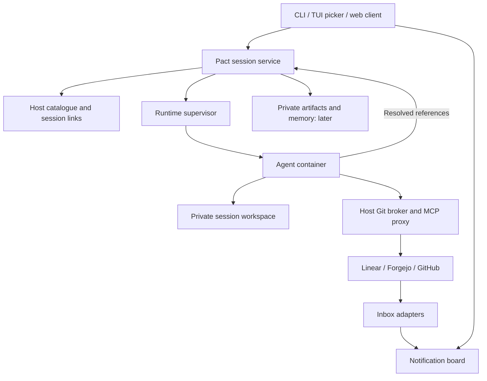

# Pact control center proposal

Pact should bring the operator's work into view, start isolated agent sessions
on demand, and make it easy to move between those sessions. An assignment can
begin with an issue, a pull request, several related issues, or a loose aim such
as "investigate deployment failures." Exploration can produce further issues,
PRs, designs, and investigations.

Status: proposed direction, 21 October 2026. This document records product and
architecture decisions for review and later task breakdown. It implements no
new behavior and does not specify a final CLI, API, database schema, or UI.

The [session management proposal](session-management.md) describes the existing
foundation and its original roadmap. [Native Codex discovery](codex-discovery.md)
records the current harness integration. This proposal extends that foundation
with managed workspaces, aggregation, private knowledge, and eventual approvals.

## Product boundaries

Pact owns agent sessions, their execution environments, and private working
context. Linear, Forgejo, and GitHub continue to own issues, PRs, projects,
milestones, and their statuses. Pact can display those relationships without
introducing its own planning hierarchy.

The core unit is a session. There is no separate Pact work item, project, or
collection required to start work. Large efforts can be organized externally,
then addressed through one or more sessions. Sessions can refer to work across
providers without requiring a local copy of their issues or project structure.

Initially run work and personal contexts in two segregated Pact installations,
each with its own configuration, credentials, catalogue, session storage, and
private knowledge. A combined work/personal inbox, account switching, and
cross-installation synchronization are not required. Each installation can use
named connections to the external services it needs.

Target one operator and one execution host per installation. Keep client
interfaces independent of the service that manages sessions. Distributed
scheduling, organization-wide roles, a general workflow engine, and automatic
decomposition into teams of agents are outside the initial scope.

## Everyday workflows

### Refer to external work in a prompt

The operator starts a session and asks "fix the bugs in PR 123 in repo foo, and
handle issues 456 and 457 while you're there." The prompt can contain natural
language, URLs, or explicit external references. No search, item-selection form,
or pre-linking step is required. The operator may have found the work in Pact's
inbox or directly in an external system.

Pact creates the session without waiting for reference resolution. In its
private workspace, the agent looks up the referenced work through its normal
tools, clones authorized repositories as needed, and records links as it
identifies relevant items. Ambiguous references can be clarified in the
conversation. The operator can inspect output, send another prompt, or take over
in the native TUI.

A request should become durable before the client reports acceptance. The
initiating terminal or browser can disconnect while supervised work continues.
Repository provisioning and agent startup may happen after acceptance; their
failures remain visible under the allocated session.

### Start with an investigation

The operator asks "investigate deployment failures across the application and
infrastructure." No issue, repository selection, or output type is required.
The session can start without a clone and bring in code or external context as
the investigation develops.

The agent might produce a private design, draft several issues, implement a
small fix, or conclude that no further work is needed. When instructed to create
issues or PRs, it performs ordinary external actions and links the resulting
records to the session. Follow-up work can continue there or start new sessions.
The original investigation and its evidence remain available.

This is a recurring loop, not a fixed pipeline from issue to code to PR.
Completing a session and changing the status of a linked issue are separate
actions. An agent can complete an investigation while leaving an issue open, or
complete several issues during one implementation session.

## Sessions and external references

The current lifecycle is described in [session management](session-management.md).
A session owns its initial backend binding, storage, and settings. Future external
references and artifacts can be attached without restoring an environment entity:

| Concept | Responsibility |
| --- | --- |
| Session | One initial backend conversation binding, workspace, storage, settings, external links, and private artifacts |

| Workspace | The private working directory, containing zero or more repositories and other working files |

| Execution | One live attempt to run the agent or native TUI, with its resources and outcome |
| External reference | A connection type, named connection, and source-specific item identity linked to a session |
| Artifact | A retained private output with revisions and provenance |

External links are many-to-many. One session can address several issues and
produce several PRs; several sessions can contribute to the same issue. A PR
belongs to its source repository, but that does not constrain the session's
scope. Links can be added after work begins. Preserve enough provenance to
distinguish supplied context from results the session produced.

Use a lightweight reference of the form
`<connection_type>:<connection>:<item_id>`. For example,
`forgejo:internal:ag/pact#55` identifies item `ag/pact#55` through the configured
Forgejo connection named `internal`. The connection resolves the endpoint and
identity; the item locator retains its source-specific meaning. An issue number
alone is ambiguous across repositories and connections. A URL can be retained
for navigation without importing the item's contents or lifecycle into Pact.

These references tag sessions with work they touched. The operator can supply
them, or the agent can record them through a session-scoped operation after
looking up or creating an item. Keep the mechanism small; exact command/API
spelling is left to task breakdown. Links are informational and do not grant
permissions or constrain what else a session can investigate.

The inbox can retain the notification information needed for display and
freshness, but does not require a synchronized issue/PR database. Fetch current
item details through the source when needed. Starting or continuing a session
does not depend on the item being present in the inbox, and discovering an item
does not itself launch an agent.

## Session service and execution ownership

Use a small host-side service to coordinate the catalogue, workspace allocation,
and execution. Reuse the existing SQLite catalogue and concrete runtime helpers;
do not introduce a general backend or connector framework before it has actual
consumers.



The supervisor owns containers, bridges, sidecars, credential snapshots, and
cleanup. Their lifetime follows the execution, including after a submitting
client disconnects. The current foreground launcher owns these resources;
detaching a process without transferring their ownership is insufficient.

Execution ownership and crash recovery are already tracked by
[#8](https://forge.alexghr.me/ag/pact/issues/8). Reuse that work rather than
creating another ownership implementation. It covers the foreground launch
boundary; detached supervision and a durable queue build on it later.

Acquire exclusive environment and workspace ownership before execution. All
launch paths, including the existing CLI and native resume, must honor it.
Threads within a session share that workspace and are coordinated as one writer.
Independent sessions have independent workspaces and can run concurrently within
configured resource limits. Multiple clients can observe a session.

Record accepted inputs and their resolved thread targets before dispatch. Queue
follow-ups in a defined order. A later TUI selection must not redirect an input
that was already accepted for another thread. Client retries should identify
the same accepted request without starting duplicate work.

Track queued, starting, running, waiting, and terminal outcomes without treating
an agent's successful exit as proof that an external issue is complete. When
approval support arrives, distinguish a pending tool operation from the whole
execution: other independent tool calls may still be active.

Recover by inspecting recorded processes and containers, not just expired
timestamps. A replacement writer must not start while the previous agent or its
tools can still write. Reconcile uncertain dispatch or external-action outcomes
before retrying; acceptance deduplication cannot guarantee exactly-once upstream
side effects after a crash.

### Native TUI handoff

Keep native Codex as the interactive interface. The existing flow is sufficient:
stop the automated execution, then run `pact resume <N>` in a terminal to enter
that session interactively against the same workspace and private state. The
operator has already exercised prompted execution followed by interactive
resume. Preserve this behavior; seamless live attachment is optional.

The new supervision work must make stopping the automated execution and
releasing its ownership reliable so the existing resume path can take over.
An orderly takeover stops the previous agent and its tools, settles or cancels
pending operations, and refreshes saved thread metadata. Preserve uncommitted
files and unfinished Git state. Resolve the conversation within the requested
session, using an explicit thread ID when needed, rather than choosing a
globally latest conversation. An interrupted handoff remains recoverable.

The handoff preserves files and conversation history, not running processes or
an in-memory turn. Later returning to automated execution uses the same ownership
rules. Future live app-server attachment requires validation against the pinned
Codex version and must retain Pact's control over writers.

## Workspace provisioning

Start with one ordinary private directory per new session, containing ordinary
Git clones. Here "workspace" means a directory, not Git's linked-worktree
feature. A session might acquire this layout during an investigation:

```text
sessions/42/workspace/
  application/
  infrastructure/
  documentation/
  observability/
```

The initial request can identify a repository to clone, but repositories are
optional and plural. Agents may clone additional repositories authorized by the
host's Git configuration as needed. Existing whitelisting controls authenticated
Git access; it is not an internet-wide restriction on reading public sources.
Keep Git keys and upstream MCP credentials on the host.

Run cloning, Git inspection, hooks, builds, and repository commands inside the
container. Host broker code must continue to avoid executing Git against an
agent-writable repository. Workspace allocation and user-supplied paths must
not grant access to arbitrary host directories.

Resume reuses the workspace, including untracked files, local commits, merge
state, and build output. Completing a turn or stopping a container does not
delete it. Initially make workspace cleanup explicit, distinguish managed
directories from operator-supplied ones, and preserve private artifacts and
memory independently of workspace deletion. A missing retained workspace is a
recovery condition, not permission to create an empty replacement silently.

Accept duplicated clone and build-output costs initially. Repository parking,
shared Git objects, linked worktrees, sparse checkout profiles, and automatic
retention are deferred optimizations. Revisit them with measured disk usage and
isolation requirements; none is a prerequisite for the control center.

## Aggregation and interfaces

Provide two useful views: an inbox as a notification board for the operator,
and sessions showing work already started. The board can surface review
requests, mentions, assignments, and other useful notifications from Linear,
Forgejo, and GitHub, with links to their sources. Email is a possible later
source. It helps the operator notice work without replicating issue tracking.

The operator can read a notification, open its source, then start or continue a
session with an ordinary prompt referring to that work. A UI may optionally
prefill a reference from a notification, but searching and clicking items is
never a required assignment step. Agents retrieve issue/PR details using their
normal tools and can record session links after discovery.

Inbox adapters retrieve notifications and the minimal information needed to
display them; client adapters present the board and invoke session operations.
Both use the same host service. Start with one source and expand without making
its vocabulary the core model. Choose direct APIs or existing MCP integrations
according to the first source's needs; this proposal does not require every
source to be implemented as an MCP.

Polling and explicit refresh are sufficient starting points. Show freshness and
source errors. A failed refresh must not appear as an empty inbox or delete
session links. Imported issue bodies and comments are external context, not
trusted Pact instructions.

The session overview should emphasize what needs the operator's attention:
waiting for input, ready for review, running, queued, or failed. Show each
session's aim, relevant links, latest meaningful output, and pending decisions.
Opening a session exposes its conversation/output, artifacts, and controls to
continue, interrupt, or enter the TUI. Browsing must not start model work.

Multiplexing means switching attention between durable sessions while the
others continue. It does not require a grid of terminal emulators. A small
local web application is a useful candidate for the overview and artifact
review; CLI and TUI clients can expose the same operations. Final UI selection
is open. The CLI remains the primary route into the native agent TUI.

Slack and Telegram are optional later clients or notification destinations.
They must reuse the session service, ownership rules, and approval records.
They do not receive their own scheduler or implicitly publish private output.

## External transparency

Externally, agents should act as they would when running under the operator's
supervision directly on the host. Use ordinary configured accounts, Git
identities, issues, comments, commits, branches, and PRs. Pact adds no branding,
footers, session IDs, labels, tracking comments, or backlinks to private state.
Starting, resuming, or finishing a session causes no automatic external action.

Store session associations and action receipts in Pact. Require no custom
repository layout or changes to upstream project organization. A request to
post an ordinary status update is still possible; it is an explicit external
action subject to the configured account policy.

An agent-owned Forgejo account can identify the agent normally. Transparency
means that Pact adds no coordination footprint; it does not require hiding or
rewriting the configured actor's identity or normal Git signatures.

## Private artifacts and memory

Build this after the inbox, session, and orchestration slice is usable. The
following requirements describe later work and must not become prerequisites
for the initial prompt-to-session or notification-board experience.

Artifacts are for the operator's private consumption: designs, investigation
reports, evidence, proposed reviews, and draft issue content. Keep named
revisions, their originating session/thread, supporting external references,
and relevant repository revisions. A review based on an older PR head should
remain identifiable as such when the source changes.

Store retained artifact content outside code checkouts, with a bounded,
session-scoped way for agents to read and write it. The host catalogue remains
outside agent mounts. Artifact operations must not become arbitrary host file
access. Persist artifacts through container replacement and workspace cleanup.
The initial storage format and editing interface remain implementation choices.

Artifacts themselves and their revision histories stay Pact-only. An operator
can ask an agent to derive ordinary external issue text or a PR description
from a private design. That publishes the selected outgoing content, not the
artifact, its private discussion, or a public artifact URL. External posting
must not automatically append private notes, memory, or Pact links.

Memory retains useful context between conversations: operator preferences,
discoveries, and decisions. Keep entries inspectable, editable, removable, and
linked to their evidence. Distinguish operator guidance from agent observations;
agent-written memory is not a higher-priority instruction source.

The [project knowledge proposal](project-knowledge.md) explores an optional
workspace-scoped store and structural index. Reuse its provenance and freshness
principles. Disposable session workspaces introduce a further question: which
knowledge should be explicitly reusable across sessions or repositories?
Do not infer broad sharing merely from a matching remote URL. Decide those
scopes deliberately, keeping personal/work contexts and private drafts separate.
The initial work/personal separation comes from the segregated installations;
cross-installation sharing is outside this proposal.
Automatic transcript ingestion, a vector database, and background summarization
are not prerequisites.

## Future permissions: using the operator's identity

Agents continue to run with YOLO execution inside their sandbox: ordinary file
access, code execution, internet access, and retrieval of relevant issues remain
available. The additional permission boundary concerns actions performed through
Pact-provided or brokered capabilities, especially publishing under the
operator's account.

Policy belongs to the configured connection and identity, not solely to a
provider name. The same provider might host either a personal or agent account.
The intended initial policy is:

| Connection/action | Intended behavior |
| --- | --- |
| Reads through an authorized connection | Allow without review |
| Sensitive writes using the operator's GitHub or Linear account, such as issue creation or comments | Require operator review |
| Ordinary writes using the agent's own Forgejo account | Allow under that account's permissions |

This permission feature is deferred. Today's MCP proxy forwards configured
tools without filtering; the current runtime must not be described as enforcing
the proposed review policy. Host-held credentials and connection/session
identity provide a place to introduce it later.

### Keep the proxy gate small

The existing [MCP bridge](mcp-bridge.md) is an HTTP reverse proxy, not an MCP
server implementation. A first approval gate can remain a small handler around
it: parse the request envelope, identify `tools/call`, match a host-configured
regular expression against the tool name, and either forward or await review.
Match the parsed name, not arbitrary text in a request body. Keep the agent's
tool names and argument schemas unchanged.

For a gated call, record the session/execution, connection/account, tool,
destination, and exact arguments before notifying the operator. Show the actual
outgoing content for review. Nothing reaches the upstream until approval.
Approve once forwards that operation; rejection returns a tool error with
optional feedback. A changed payload requires its own review. If tools have
generic names and select actions through arguments, name matching alone may be
insufficient; address concrete integrations when they arrive.

Apply protection at each credential-bearing route capable of the protected
action. A personal-account API or Git path outside the gate could otherwise
perform the same action. Keep upstream credentials out of the container rather
than relying on instructions to make an agent request permission.

Bind decisions to the pending operation and recheck that it is still live before
dispatch. Timeout, cancellation, takeover, or termination of the originating
MCP call must not let a stale approval start an abandoned request. Record
dispatch and result separately; an uncertain upstream outcome requires
reconciliation rather than an automatic retry that could post twice.

### How the agent waits

Holding the ordinary tool call preserves the existing interface. The agent waits
for its result; Pact independently knows the operation is awaiting approval and
can show that state to the operator. This does not require the model to invoke
a separate approval tool or freeze the agent process.

MCP offers several patterns with different costs:

| Pattern | Use and limitation |
| --- | --- |
| Held call, optionally with progress | Smallest proxy extension; still bounded by client and transport timeouts |
| Elicitation | Explicit human input with accept/decline/cancel responses; requires client support and request/reply routing |
| Tasks | A durable task handle for long waits and reconnects, including input-required states; requires compatible protocol/extension support |

[MCP progress](https://modelcontextprotocol.io/specification/2025-11-25/basic/utilities/progress)
uses `notifications/progress`. A supporting client supplies
`params._meta.progressToken`; Pact can then report "awaiting your approval"
while the call remains pending. The token is MCP client metadata, separate from
the tool arguments the model normally generates. Do not instruct the model to
add it through `agent-instructions.md`, or insert it into upstream arguments.
Correctly attached metadata also works for instant calls; the receiver may
simply return without any progress notifications.

Progress is optional and not guaranteed to be visible to the model. Do not emit
it without a client-supplied token or make notification delivery depend on it.
Generating progress requires some response-stream handling in the proxy, beyond
merely delaying forwarding.

[Official Codex MCP documentation](https://learn.chatgpt.com/docs/extend/mcp?surface=cli)
currently documents `tool_timeout_sec`, with a default of 60 seconds. Gated
connections need an intentional waiting deadline and compatible timeout
configuration. Progress does not promise an indefinite connection:
[MCP timeout rules](https://modelcontextprotocol.io/specification/2025-11-25/basic/lifecycle#timeouts)
allow progress to reset a timeout while retaining a maximum duration.

[Elicitation](https://modelcontextprotocol.io/specification/2025-11-25/client/elicitation)
and the [MCP Tasks extension](https://tasks.extensions.modelcontextprotocol.io/)
are candidates for richer or durable waits. The
[Codex app-server documentation](https://learn.chatgpt.com/docs/app-server#mcp-server-elicitation-requests)
describes forwarding elicitation requests to its client. These protocol
descriptions do not establish support or behavior in Pact's pinned binary,
especially during noninteractive execution with its current approval policy.
Validate capabilities, rendering/routing, cancellation, and timeouts against
that binary before choosing a mechanism. Do not return task handles to a client
that has not negotiated support.

Start with the proxy gate and a defined timeout if that meets actual review
needs. For unattended waits lasting hours or across restarts, investigate Tasks
or an explicit supervised continuation; do not assume a parked HTTP connection
provides durable suspension. Agent instructions can explain waiting/rejection
behavior and discourage unchanged retries, but they neither configure MCP
metadata nor enforce permission decisions.

## Notifications after permissions

The approval feature first needs a way to inspect and resolve pending requests
through the local Pact interface. A subsequent notification client can stream
those requests to the operator's MacBook, then send approval/rejection decisions
back to the same service. Socket forwarding over SSH or a WebSocket through an
SSH tunnel is sufficient; the exact transport and Mac presentation are open.

Store approval state on the execution host. A notification is a view of that
state, not the authority to run a tool. Reconnecting clients should retrieve
pending requests and resume an ordered event stream from a cursor. Delivery
retries do not redispatch operations. Disconnecting or missing a notification
never counts as approval; resolved, cancelled, and expired requests remain
recognizable so stale UI actions cannot release them.

Keep the operator control channel authenticated and separate from the bridge
available to agents. The bridge can request an operation but cannot approve it.
A review should identify the session, account, destination, and full outgoing
content, with access to session context. Other events such as completion,
failure, or requests for clarification can use the same stream later.

## Delivery shape

Use this proposal to create small implementation tasks after design review.
These are capability boundaries, not a pre-created issue list or fixed schema:

1. **Reliable ownership and supervision.** Complete the ownership/recovery
   foundation tracked by [#8](https://forge.alexghr.me/ag/pact/issues/8), then
   extend runtime lifetime beyond the foreground CLI for supervised work. Reuse
   the existing `pact resume <N>` flow after stopping an automated execution.
2. **Prompt-to-session workflow.** Allocate private directories, accept loose
   aims, let agents acquire authorized repositories, retain outputs, and support
   detached follow-ups. Preserve existing operator-supplied workspaces.
3. **Inbox and session navigation.** Add one notification source, lightweight
   references, and a useful inbox/session overview through the common service.
   Preserve prompt-first assignment without a required item-selection workflow
   or issue mirror. Expand source support to Linear, Forgejo, and GitHub.
4. **Private artifacts and memory.** After the inbox/session/orchestration slice
   is usable, add retained drafts and iteration, then explicit reusable knowledge
   with inspectable scope and provenance.
5. **Sensitive-action review.** Add connection/account policy and the small
   proxy gate, local review, cancellation, and honest timeout behavior.
6. **Remote notifications.** Stream durable approval requests and decisions to
   the MacBook; extend the same channel to other useful session events.

Permission and remote-notification support need not be built in the first
session release. Preserve host-held credentials, session-bound requests,
execution ownership, and explicit event/state boundaries so they can be added.
Shared-repository storage and seamless live TUI attachment remain optional.

## Decisions left for task breakdown

- Which external source and notification query provide the first useful daily
  board? What is the smallest session-scoped operation for recording references
  the agent resolves from a prompt?
- Which overview client should ship first, and how should it invoke native TUI
  takeover on a different execution host?
- Which output items should be retained and replayed, with what size limits?
  The current catalogue records metadata, not a complete presentation transcript.
- What are the initial execution limits and workspace/artifact retention controls?
- What artifact editing/storage format and cross-session memory scopes are useful
  before adding richer retrieval or indexing?
- Which tool-name patterns cover each chosen personal-account integration, and
  how are new or ambiguous tools reviewed as integrations change?
- What waiting duration is required, and does the pinned Codex support a suitable
  durable input mechanism without changing ordinary tool interfaces?
- How should private drafts be revisited when source issues, PR heads, or target
  permissions have changed since the original investigation or review?

## Validation boundaries

This design-only change needs document review, relative-link checks, and diff
validation. It makes no claim that the proposed runtime, permissions, or client
capabilities have been implemented or integration-tested.

Implementation tasks should verify observable behavior with real components:
independent sessions cannot write each other's workspace/state; disconnecting an
observer does not cancel supervised work; takeover leaves no competing writer;
resume preserves unfinished work; source refresh failures preserve known links;
private artifacts survive workspace cleanup without appearing in code commits;
and rejected, cancelled, or expired operations never reach the upstream.

Use real protocol clients, sockets, temporary repositories, and the existing
catalogue. Validate harness-dependent behavior against the pinned Codex, and
upstream publication behavior with suitable test accounts. Report the checks
actually performed and the limitations of unavailable integrations. Do not
substitute tests that merely assert schema declarations or expected tool lists.
