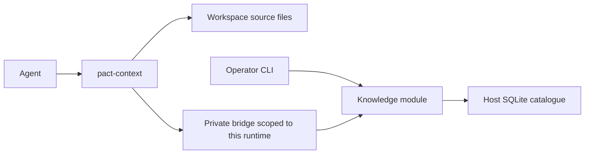

# Pact project knowledge proposal

Give each fresh agent a small amount of durable context: the operator's working
preferences, an overview of the current workspace, and a way to find relevant
code and previous discoveries. Store this knowledge in local SQLite and generate
the repository index at runtime inside the container. Let agents update the
knowledge as they work.

Status: proposed experiment, 10 October 2026. The commands, tables, and modules
below do not exist yet. This document specifies a design, not a measured
performance improvement.

## Purpose and scope

Pact is a way to learn how useful coding agents are assembled and to improve one
operator's workflows. An inspectable implementation and understandable behavior
are outcomes in their own right. This experiment does not need a novel memory
algorithm or a hosted product to justify itself.

The concrete failure to address is repeated rediscovery. In a project with a
`foundation` package, an agent might implement its own delay function despite an
existing helper. Remembering every signature is unnecessary. The agent needs to
know that shared asynchronous utilities live in `foundation`, when to consult
them, and how to find the current implementation.

Start with one operator on one host, running agents in disposable containers.
Independent workspaces can run concurrently. No CI generation, cloud memory
service, vector database, additional model calls, or background summarization
service is required. Training models is outside this proposal. Use the existing
coding agent to write concise explanations during ordinary work; extract
structural facts with code.

## Context with different lifetimes

| Context | Example | Ownership and loading |
| --- | --- | --- |
| Global preferences | Use Conventional Commits; keep commits small and atomic | Operator-wide, concise, included at startup |
| Workspace overview | `foundation` contains shared utilities; consult it before adding general helpers | Agent-maintained, included at startup |
| Topic knowledge | Async utilities, design rationale, canonical examples, operator corrections | Agent-maintained, retrieved when relevant |
| Structural index | Paths, declarations, signatures, imports, documentation locations | Generated, queried when relevant |
| Task history | Current plan, attempted fixes, test output | Remains with the session and harness |

Memory explains meaning and expectations; the index locates current evidence.
Keep their different provenance even when they live in the same database.
Ordinary prose and code snippets are the model-facing representation. SQLite is
the storage format, not a binary representation passed directly to the model.

The overview links topics, and topics link source locations. For example:

```text
Workspace overview
  foundation: shared utilities; check before implementing a reusable helper
    foundation/async: delays, timers, cancellation, Promise utilities
      source: packages/foundation/src/async.ts
      examples: packages/foundation/test/async.test.ts
```

These paths illustrate another project, not Pact's layout. The generated index
provides exact declarations when requested. The overview should not enumerate
all symbols or duplicate source documentation.

## SQLite and workspace identity

Extend the host-side catalogue planned by the session-management work:
[SQLite storage and migrations (#5)](https://forge.alexghr.me/ag/pact/issues/5)
and [workspace records (#6)](https://forge.alexghr.me/ag/pact/issues/6).
Reuse its database, driver, migrations, and workspace IDs. The proposed location
is `$XDG_STATE_HOME/pact/sessions.db`, defaulting to
`~/.local/state/pact/sessions.db`. Do not create another registry or rename the
catalogue as part of this experiment.

A workspace can contain several repositories or none. Its stable catalogue ID
is the scope; `/home/pact/workspace` is only a container mount path shared by
unrelated runs. Store source paths relative to the workspace, including any
repository subdirectory. A moved workspace retains its ID through the catalogue's
relocation operation. Separate clones and worktrees initially have separate
knowledge; do not infer sharing from a remote URL or branch name.

Use a small set of tables, adding them only as their implementation slice lands:

| Table | Essential data |
| --- | --- |
| `knowledge_entries` | ID, scope (`global` or `workspace`), workspace ID when scoped, unique topic key within scope, kind, title, body, revision, origin, source session/thread when available, update time |
| `knowledge_changes` | Entry ID and revision, previous content and metadata, writer, deletion marker; enough to inspect and restore an edit |
| `knowledge_sources` | Entry ID, workspace-relative path, optional symbol, file content hash observed when the note was written |
| `context_scans` | Workspace ID, generation, scanner version, completion time, coverage/skips, optional revision metadata per repository |
| `context_files` | Workspace ID, relative path, content hash, language, scan generation |
| `context_symbols` | File record, name, kind, signature, location, declared import paths where supported |

An entry's origin distinguishes operator-written guidance, an agent-recorded
operator correction, and an agent observation. The host records which runtime
wrote it; an agent's description of an operator correction is reported
provenance, not proof of a higher instruction priority. Require a workspace ID
for workspace entries and prohibit one for global entries. Source-file references
belong to workspace entries. Only the operator CLI can mark an edit as
operator-written; the bridge records agent edits as such.

Knowledge is durable and should be backed up with the catalogue. Structural
tables are disposable: rebuilding them must not delete preferences or notes.
Use short transactions and bounded batches. Follow the catalogue's connection
and migration policy rather than introducing a second database framework.

Provide readable list, show, edit, history, restore, and export operations.
Editing can use a temporary Markdown file and an expected revision; SQLite
remains authoritative. Export is for inspection and backup, not a second live
store that needs synchronization. Initial retrieval can match topic keys,
titles, paths, and symbol names with ordinary SQL. Use `rg` for deeper source
search. Consider SQLite full-text search only after observing a retrieval gap.

## Host and container boundary

Keep the catalogue outside the workspace and never mount it into an agent
container. A direct mount would also expose session records and allow accidental
schema edits. Add a concrete `internal/knowledge` module behind the existing
private host bridge. Like the Git broker, it can serve a small internal HTTP
protocol without becoming an upstream MCP service or a separately deployed
daemon.

Add a container helper under `cmd/context-client`, installed as `pact-context`
through the existing image build scripts. It scans local files and exchanges
bounded records with the host. The host handler supports knowledge reads/writes
and structural updates, not arbitrary SQL, commands, or filesystem access.
Use camelCase JSON fields such as `expectedRevision`, `sourcePath`, and
`contentHash`.



The connection determines the workspace and runtime identity; requests cannot
choose a different workspace. Reads cover global preferences and this workspace.
Workspace writes stay in that scope. Global preference writes must be explicit,
with their own operation, so an ordinary topic update cannot become global.
This is a single-operator capability, not a new organization or permissions
system. It must never change Pact credentials, mounts, or broker permissions.

Reject invalid paths and oversized records. Source paths are references only:
the host must not open them or execute Git against the agent-writable workspace.
All Git discovery, file reads, and parsing happen in the container. Scanning
must not follow symlinks outside the workspace or execute repository code.
Close the handler with the runtime's existing bridge lifetime, and cancel
in-flight work. A future supervisor can own that lifetime without changing the
knowledge model.

## Startup and retrieval

Enable the experiment with an explicit Pact context setting. When enabled:

1. Resolve the catalogue workspace and acquire the existing execution ownership.
2. Start the scoped bridge and container. Before launching Codex, run the local
   scanner to refresh the structural index against the mounted working tree.
3. Supply a small, fixed startup instruction telling the agent to run
   `pact-context boot` before repository work. That command returns global
   preferences, the workspace overview, available topic keys, and scan status.
4. Load deeper topics and structural results on demand. Read current source
   before editing or relying on a helper's behavior.

This makes preparation and the entry point deterministic. The initial adapter
still relies on the agent following one instruction to consume the result; it
does not guarantee model compliance. Return knowledge as tool output, with its
scope and origin, instead of interpolating agent-written notes into Pact's
trusted developer instructions. Do not overwrite repository `AGENTS.md` files.
Direct startup-context injection can be evaluated later if the pinned harness
provides a suitable interface.

Use the existing [entrypoint](../internal/nix/context/entrypoint.sh) for both
interactive and prompted launches. The fixed instruction must also cover a new
task or resumed thread: fetch the current view rather than assuming old context
is fresh. Validate native `/new`, `/fork`, resume, and compaction behavior against
the pinned harness; do not assume a container launch hook runs for each of them.
The explicit boot command remains available within an existing container.

Keep startup output bounded. Begin with a 4 KiB budget for global preferences and
8 KiB for the overview and topic directory, then tune using real tasks. These
are byte budgets, not promised token counts. Reject writes that exceed the
always-loaded preference budget; report other omissions with a continuation
query instead of silently cutting a rule in half. Detailed topic reads and
searches have explicit result and byte limits too.

If a workspace has no overview, return that fact with a compact generated
directory summary. During its normal task, the agent can create the overview
after inspecting enough source. Do not schedule a separate model call or force
every first task to document the entire repository.

Existing project instructions and current explicit operator requests continue
to govern behavior. Global preferences are defaults; agent observations do not
override either. An index hit is evidence to inspect, not an instruction.
Native harness memory can remain enabled independently, but Pact neither reads
nor modifies its private store and does not rely on it to discover this system.

## Runtime generation and freshness

Start with a file inventory, documentation locations, and Go declarations and
imports extracted with the standard Go parser. Other languages initially get
paths and normal source search. Add a language parser when a real experiment
needs it; do not extract purported signatures with language-agnostic regexes.
Imports and declarations are syntax facts, not a resolved call graph.

Enumerate regular files using ignore-aware discovery, excluding VCS metadata,
generated/build output, dependencies, and the scanner's own artifacts. Bound
file size and total scan work; report skipped files and unsupported languages.
Respect ignore rules and avoid indexing ignored credentials or copied secrets.
The index stores locations and declarations, not a second copy of every file.
Distinguish deliberate exclusions from a scan that stopped before enumerating
its eligible files; coverage describes the selected files, not the entire repo.

Hash eligible file contents at startup. Reuse extraction results for unchanged
hashes and scanner versions; update changed/new files and remove deleted ones.
This still requires reading eligible files, so measure its cost rather than
assuming an index makes startup free. Commit a complete generation atomically;
an interrupted or partial scan must not delete unseen files or appear complete.
If staging requires multiple transactions, readers keep the previous generation
until the new one is complete. Discard abandoned staging records on recovery.

Treat the working tree as authoritative, including uncommitted changes. A Git
commit alone is insufficient freshness evidence. Record revision metadata per
repository only as diagnostic context. Hash references let a topic become
visibly stale when supporting files change, even without a commit.

Within a session, the agent calls `pact-context refresh` after relevant edits or
a branch switch and before querying an index it knows may be outdated. Queries
return the indexed hashes and scan status; the container helper verifies files
behind returned hits and refreshes mismatches before returning locations. Topic
reads also check their source references before reporting freshness.
This detects changed hits, but cannot discover newly added matching files until
a refresh. Make that limitation explicit; a watcher can be considered later if
manual refresh becomes a repeated failure. Files can also change after a read,
so the agent must still inspect the source it actually edits.

For a note whose source hash differs, mark the note as needing review rather
than silently rewriting or deleting it. A branch checkout can make previously
useful knowledge inapplicable. The first version uses workspace-scoped notes
with visible stale status, not a database of every historical branch. Notes
with no source reference remain unverified; timestamps alone do not establish
correctness.

## Writing knowledge during work

Use stable topic keys such as `overview`, `foundation/async`, or
`git/credential-boundary`. The agent edits the smallest relevant entry when it
creates a module, discovers a reusable pattern, or receives a durable correction.
It may save a useful discovery immediately; avoid requiring successful task
completion before anything persists. Clearly label unresolved observations and
failed approaches, and omit temporary progress that belongs in task history.

For the duplicate-helper example, save that asynchronous utilities are owned by
`foundation`, link the helper and an existing usage, and explain any relevant
cancellation constraint. Do not just save the conversation fragment saying the
operator rejected a new `sleep()` implementation.

Keep the outline small and the details in topics. Update source references when
moving code, remove obsolete guidance, and do not recursively summarize the
entire store after each task. A source hash describes what was observed; only
re-reading and reconsidering the note can validate its meaning.

Global changes require an explicitly global operator preference, such as
"I always use Conventional Commits." A project-specific correction stays in the
workspace. Agents may record both through the helper without editing instruction
files or introducing a routine approval dialog. If the intended scope is
unclear, keep it local until clarified. Operator-authored entries remain
distinguishable from agent-recorded ones.

Use an expected revision for updates and deletion. If two independent agents
edit a global preference concurrently, the second write reports a conflict and
returns the current entry; it must not silently overwrite it. Apply the same
rule to topic edits. Record history in the same transaction as the change so
the operator can inspect and restore it. Retrying a write after a lost response
must compare the persisted result before making another revision.

## Proposed interface

Keep the initial interface small and usable from a shell. The host CLI selects
a registered workspace; the container helper is already scoped by its bridge.
Illustrative commands, with final flag spelling decided during implementation:

```sh
# Host: inspect or edit the operator's persistent knowledge.
pact context list --global
pact context edit --global commit-style
pact context show --workspace ./project overview
pact context history --workspace ./project foundation/async
pact context export --workspace ./project

# Container: generated and learned context through one entry point.
pact-context boot
pact-context show foundation/async
pact-context find 'delay'
pact-context refresh
pact-context put foundation/async --expected-revision 3 --body-file /tmp/note.md
```

Return concise text by default and offer JSON for diagnostics. Include scope,
entry revision, source locations, and stale/partial status. An empty search is
not a claim that the codebase has no implementation; fall back to source search.
Explicit refresh/index status should make expensive or incomplete work visible.
An agent can use ordinary file tools to prepare a note, but commits it through
the helper so validation and revision checks apply.

## Failures and recovery

Keep context optional and easy to disable for comparison. If scanning fails,
continue with durable preferences and notes, clearly label the old index, and
use source search. Never present an empty replacement as a successful refresh.
If the enabled knowledge store cannot be read, report the failure and require
an explicit context-disabled launch rather than silently dropping preferences.
A failed knowledge write must be reported as unsaved without losing the code
change or treating an uncertain write as success.

Session archival or container removal must not delete global or workspace
knowledge. Explicit knowledge deletion affects its own records only. Provide a
restore operation for accidental edits and a rebuild operation for derived
records. Use the catalogue's supported backup process, not a copy of an active
database file. No host credentials or entire conversation transcripts belong
in this store.

## Delivery and evaluation

Implement this after the catalogue and workspace identity foundation. It does
not require the rest of the session-management roadmap, an app-server switch,
remote clients, or a supervised service. Keep each increment independently
reviewable:

1. **Durable knowledge and inspection.** Add scoped entries, source references,
   revision/history behavior, and the host CLI using the existing SQLite layer.
2. **Runtime access and startup.** Add the scoped bridge/helper, fixed startup
   instruction, and bounded boot view for both interactive and prompted agents.
   Verify persistence across container replacement and actual startup reads.
3. **Generated index.** Add runtime inventory and Go extraction, atomic refresh,
   stale-source handling, and bounded lookup. No CI producer is needed.
4. **Use the loop.** Have agents update knowledge during real tasks, inspect the
   resulting records, and adjust the overview and retrieval rules from observed
   failures. Add parsers or retrieval machinery only to address those failures.

Behavioral checks should cover scoped reads across two workspaces using the same
container path, concurrent updates without lost preferences, interrupted refresh
without disappearing entries, stale references after edits/deletions/checkouts,
and runtime cancellation. Exercise real SQLite, temporary repositories, files,
and the private bridge. Do not add tests that merely restate table declarations
or command flags. Verify that scanning does not execute a repository hook or
follow a source symlink outside the workspace.

Separately, compare a correctly configured native harness with: global
preferences alone; preferences plus a workspace overview and learned topics;
and those features plus the generated index. Use the same task snapshots,
model/settings, and repeated fresh sessions. Keep evaluation tasks separate
from tasks used to seed learned notes. For a warm-start experiment, state
exactly what prior work was allowed to populate memory.

Include helper-reuse tasks, an operator correction that should survive a new
container, and a code change that should invalidate old guidance. Measure
successful completion, duplicate helpers, operator corrections, discovery
round trips, elapsed time, input tokens/cost where exposed, scan time, and
knowledge-maintenance effort. A faster first edit alone is not success.

Run implementation checks with `./shell p-ci`, which includes the launcher
build, and report optional real SSH/Docker checks separately when relevant.
The design-only change needs document review and link/diff validation; it adds
no executable behavior to test. The experiment's useful output is a working,
inspectable loop and evidence about which parts help this operator. Remove or
simplify parts whose ongoing cost exceeds their benefit.
