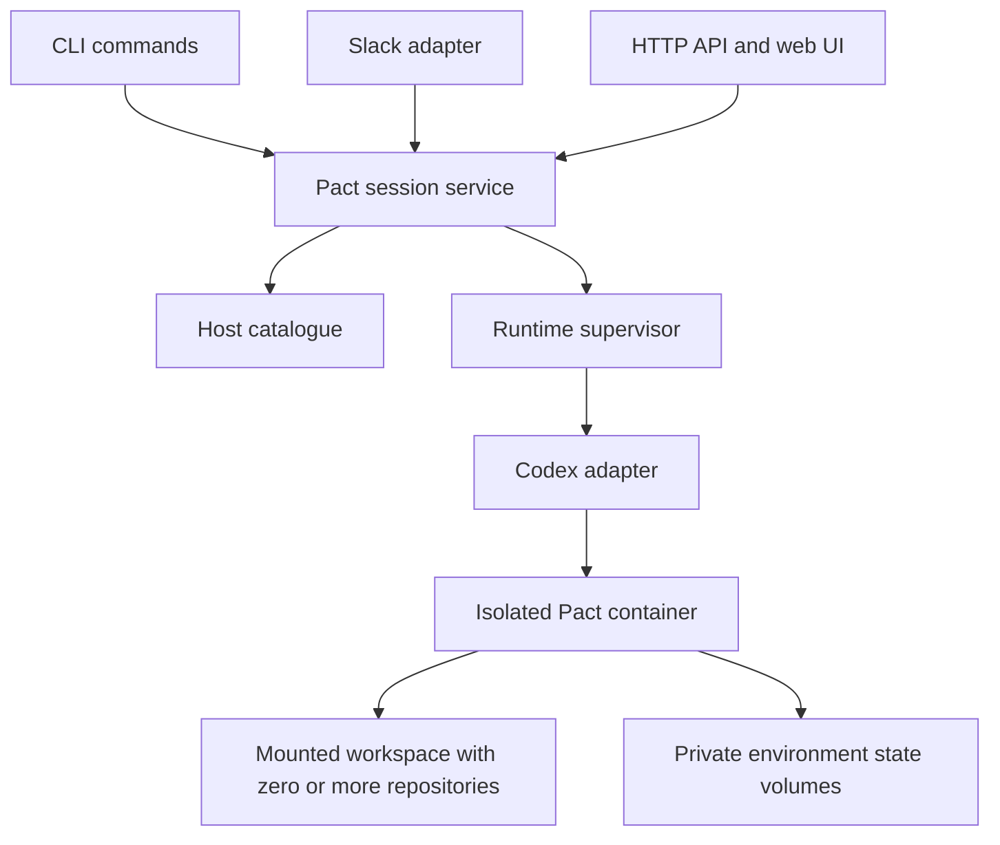

# Pact session management proposal

The broader product direction is now described in the
[control center proposal](control-center.md): sessions can begin with loose
aims, span repositories and external systems, and retain private artifacts.
That proposal guides new control-center work; the runtime and discovery details
below remain the foundation and record which CLI capabilities already exist.

Pact should make a conversation resumable regardless of whether it began in a
terminal, with `--prompt`, in Slack, or through a web API. Introduce a host-side
session module that records the conversation's identity, workspace, storage, and
execution state. Keep Codex responsible for its own conversation history and
expose the same Pact operations to every client.

Start with reliable discovery and explicit resume in the CLI. Then add a
supervised service in a later slice when detached work or remote clients are
needed. Preserve the native Codex terminal interface throughout this transition.
The first implementation slice keeps `codex exec` and the native TUI; an
app-server switch is an optional next slice if more control proves necessary.

The initial design supports workspaces containing multiple repositories and
independent sessions running in separate containers. Different workspaces may
run concurrently. Foreground launch and resume now retain OS ownership of the
canonical workspace, environment, and private state volume through cleanup.
Docker resource recovery is described below.

Status: initial CLI implemented, 18 October 2026. `pact sessions list`, `show`,
and `threads` expose the host catalogue; `pact resume ID[:THREAD_ID]` continues
saved native conversations, with `--prompt TEXT` for prompted continuation.
The picker, `pact send`, `pact serve`, archive
management, and legacy import remain proposed interfaces below.

The native adapter and its version constraints are documented in
[Codex discovery](codex-discovery.md). Resuming asks the bundled app-server for
saved metadata before selecting a thread. A passive observer refreshes the
catalogue during native TUI use; refreshes also run at startup and after
execution, including handled interruption. Listings use the host cache
without starting model work or warning about routine refreshes. Saved settings include
model, effort, DinD, and host networking. Resume uses the current host Git/MCP
configuration and host ChatGPT login; see [authentication](#authentication).

Implemented foundation, 16 October 2026: the host SQLite catalogue now records
workspaces, environments, sessions, and executions. Each validated launch prints
its session ID before runtime setup. Launch records preserve model, effort,
interactive/prompted mode, DinD selection, timestamps, and the final outcome.
The schema records the backend explicitly and uses generic state-volume fields.
New environments now use private agent-state volumes and one catalogue-managed
Nix daemon/store. See [storage, recovery, and legacy history](nix-storage.md).

Execution `running` and its start time describe the foreground Docker client,
not readiness of a model turn. Build/setup failures and Docker's reserved
startup exit codes become `startupFailed`; other container failures become
`failed`. Normal exit becomes `succeeded`, and handled SIGINT/SIGTERM becomes
`interrupted`. Final bookkeeping has its own bounded context after resource
cleanup. A hard crash can leave an unfinished record; recovery inspects Docker
before permitting a replacement.

### Foreground ownership and recovery

Execution lock files live beside the host catalogue, outside the mounted
workspace. Busy errors identify the owning session, execution, and launcher PID.
The PID is diagnostic; releasing a kernel lock does not prove a container stopped.
Independent workspaces and private stores can execute concurrently. The existing
storage lock still serializes provisioning and reclamation.

`execution_resources` records each agent, history helper, DinD container, and
DinD socket volume before creation. Resources carry environment, workspace,
session, execution, and unique resource labels. Container creation and attachment
are separate operations; Pact records the actual container ID and image digest
before starting it. Shared Nix resources retain their existing storage ownership.

After acquiring ownership, recovery inspects unfinished executions and resources
whose cleanup failed. It removes only stopped resources with matching ownership
and identity. Running, paused, restarting, changed, or uninspectable resources
block replacement, with their names and an explicit operator recovery action.
Uncertain executions remain visible; no prompt is replayed. Once resources are
confirmed stopped and removed, the old execution becomes interrupted. Execution
resources are recorded before creation, so an unfinished execution without
resource records can be marked interrupted without querying Docker.

Stop agent and DinD containers started by older Pact versions before upgrading.
Recovery inspects recorded resources; it does not scan for containers started by
versions that did not record their resource identities.

Normal exit and cancellation stop the agent and sidecar before the final native
history refresh. Cleanup failures are reported and retain durable resource
records for the next recovery attempt; they do not count as proof of termination.

## Authentication

Each launch and resume requires a file-based host ChatGPT login at
`~/.codex/auth.json`. Pact creates an owner-only temporary snapshot containing
the access token, ID token, account ID, and original `last_refresh`. It supplies
an empty `refresh_token` to satisfy the native Codex login parser. Unknown fields,
refresh credentials, and API keys are excluded. Unsupported login modes fail
before container startup, without falling back to saved credentials or API use.

The snapshot is mounted read-only at `/home/pact/.codex/auth.json` and removed
from the host after runtime cleanup. The original host login is never mounted.
Access and ID tokens, including their identity claims, remain readable inside
the agent container; this does not narrow their upstream permissions. Snapshot
credentials are not copied into persistent agent state.

The network-isolated history helper removes legacy saved `auth.json` copies
before starting Codex. It runs before resume and after runtime exit, so old
credentials are discarded when reopening saved history. The DinD sidecar mounts
the workspace without Codex storage or credentials.

Every invocation reads the current host login. Running containers cannot refresh
or replace their snapshot; after access expires, renew the host login with
Codex CLI and restart or resume the session. Pact does not refresh or write
host credentials.

## Original prompted-session discovery investigation

The original investigation pointed to a discovery problem rather than deliberate
deletion. Passing a prompt is a supported Pact workflow.

Before managed storage, [the launcher](../cmd/pact/main.go) mounted
`pact-codex-state` at `/home/pact/.codex` and `pact-codex-state-nix` at `/nix`.
Docker's `--rm` removes the container, but these named volumes survive. In
[the entrypoint](../internal/nix/context/entrypoint.sh), a nonempty prompt selects
`codex exec --skip-git-repo-check --ignore-user-config`; an empty prompt selects
the interactive interface. Pact never passes `--ephemeral`.

The then-installed `codex-cli 0.160.0` distinguished discovery by source:

| Codex option | Effect |
| --- | --- |
| `resume --include-non-interactive` | Includes prompted sessions in the picker and `--last` selection |
| `resume --all` | Removes the working-directory filter |
| `resume <id>` | Selects a particular saved conversation |
| `exec --ephemeral` | Disables session persistence |
| `exec --ignore-user-config` | Skips user configuration; does not disable persistence |

These options were checked against the installed binary's help. The resume
options are also described in the [official command reference](https://learn.chatgpt.com/docs/developer-commands#codex-resume).
Noninteractive continuation is supported with `codex exec resume <id>`.
[Official noninteractive documentation](https://learn.chatgpt.com/docs/non-interactive-mode#resume-a-non-interactive-session)

For diagnosis, invoke the following **inside an environment using Pact's existing
Codex volume and the correct workspace**:

```sh
codex resume --include-non-interactive
# If the saved directory differs:
codex resume --include-non-interactive --all
```

These are Codex shell commands, not `/resume` arguments. Running them against
the host's ordinary `~/.codex` searches a different store. Pact now provides
`pact resume ID[:THREAD_ID]` for conversations in its managed private stores;
it does not forward arbitrary Codex arguments.

This explains the reported symptom, but does not establish that every missing
conversation still exists: no particular historical session was recovered in
this investigation. If an explicit lookup fails, check the actual image version,
volume, archived state, and persistence errors before concluding that history
was deleted.

In the legacy layout, every host workspace appears to Codex as
`/home/pact/workspace`, and all workspaces share one Codex volume. Codex's
directory filter therefore cannot reliably distinguish Pact projects. A global
`--last` can select a conversation belonging to a different repository.

## The model Pact should own

A Pact session is a durable working context associated with a workspace and an
owner. It contains multiple Codex threads and survives terminal exit, turn
completion, and container replacement. Each thread is a conversation with its
own history. Use separate identities for these concepts:

| Record | Meaning and essential fields |
| --- | --- |
| Workspace | Integer ID, owner, canonical host directory, optional metadata for repositories beneath it |
| Environment | Opaque ID used for resource ownership and Nix roots, workspace ID, private agent-state volume, shared Nix store reference, container mount path, configuration profile |
| Session | Incrementing integer ID, environment ID, title, owner, backend, creation and last-use times, cached last used thread ID, archive state |
| Thread | Session ID, native Codex thread UUID, title, optional parent thread ID, creation and last-use timestamps, archive state |
| Turn | One accepted input and its outcome; Pact ID, session and thread IDs, backend turn ID when available, actor, request key, timestamps, error |
| Runtime | A live execution instance; environment ID, container ID, image digest, Codex version, owner lease, heartbeat |
| Binding | External conversation identity mapped to a particular Pact session and Codex thread, such as a Slack workspace, channel, and thread |

A workspace is an arbitrary directory and need not itself be a Git repository.
It can contain `backend/`, `frontend/`, and `infrastructure/` repositories plus
notes or other files. A session can work across all of them. Repository
metadata belongs to individual repositories; do not assign a single branch,
remote, or commit to the whole workspace. Start with one mounted root directory,
without introducing a project manifest or repository provisioning system.

Each new independent session gets its own environment by default; resuming
reuses that environment. All threads within a session use its environment and
storage references. Creating or forking a thread does not allocate another Pact session
or another private volume. Independent Pact sessions keep their thread stores
separate.

Allocate session IDs as increasing positive integers, starting at `1`, within
the Pact catalogue. Allocate them transactionally in SQLite and never reuse a
previously issued ID after deletion; gaps are acceptable. IDs are local to the
catalogue, not globally unique. Preserve native thread IDs as opaque strings;
Codex currently uses UUIDs.

Use `session-ID:thread-ID` to identify a particular conversation, where the
session component is an integer and the thread component is the Codex UUID.
Validate that the thread belongs to the specified Pact session. Do not assume
a Codex thread ID, a backend session-tree
ID, a Docker container name, and a Pact session ID are interchangeable.

Inside the TUI, `/new` adds a saved thread after its first input, `/fork` adds a
saved conversation, and `/resume` lets the operator move between its
threads. Pact retains the same session identity throughout. These operations
change conversation context; they do not snapshot or restore workspace files.

### Selecting a thread to resume

`pact resume 42:0199a213-81c0-7800-8aa1-bbab2a035a53` resumes that exact thread.
`pact resume 42` resumes the last used saved thread in session `42`,
regardless of whether it originated in interactive or prompted mode. The UUID
here is illustrative; use the thread ID reported by Codex. Default selection
considers the operator's conversations, including forks; internal subagent threads remain
associated with their parent and do not take over the default resume target.

Use Codex's saved recency, including view-only opens when Codex persists them.
Reopening A in a fresh process after working in B makes A the default target.
Switching back to an already-loaded thread may not update native recency; this
slice accepts that native limitation rather than tracking every TUI switch.
An empty unsaved `/new` leaves the previous saved conversation as the target.

Refresh the session's metadata before choosing the default. Use Codex's native
protocol `updatedAt` in seconds, with descending thread-ID order for equal timestamps. Pact
does not classify transcript events, infer meaningful activity, or maintain a
separate activity-certainty flag. Native metadata is the source of truth;
an unpersisted native update can be lost in a crash.

If a newly created session has no threads, start its first thread. If the
selected thread is missing, archived, or unreadable, report that condition;
never silently substitute an older thread or a new conversation. An explicit
combined ID remains available to select a known thread.

`pact resume ID[:THREAD_ID] --prompt TEXT` (also `-prompt`) resolves its target
once after refreshing native metadata and invokes `codex exec resume` with that
exact UUID. It retains the Pact session and environment, records prompted mode,
and uses the same readable output and activity bookkeeping as a new prompted
launch. Prompted resume requires a saved thread; empty sessions cannot silently
start a replacement conversation. Pact's approval and sandbox configuration is
also applied to native prompted continuation, and the event reader rejects a
different UUID before recording any thread observation.

## Module and runtime boundaries

Add `internal/session` as a transport-independent Go service. Its initial
operations should be `Create`, `List`, `Get`, `ListThreads`, `Submit`, `Observe`,
`Interrupt`, `Archive`, and `Unarchive`. Pass an actor and request ID to
mutations. Keep Docker and Codex protocol details behind concrete adapters;
there is no need for a general plugin framework yet.



The catalogue owns routing, access rules, turn acceptance, and Pact lifecycle
events. Codex owns its transcript and continuation format. A runtime supervisor
owns containers, bridges, sidecars, and their cleanup. Client adapters translate
input and present results; none should implement a second session scheduler.

Container, volume, and image operations go through
[`internal/docker`](../internal/docker/docker.go), including mount encoding and
attached I/O. [`internal/sidecar`](../internal/sidecar/nix.go) starts the shared
Nix daemon and private DinD containers. Storage provisioning and retention remain
in `internal/environment`; execution ownership and recovery remain in
`internal/execution`. Bridge, broker, and private DinD lifetimes follow the
launcher and must follow future supervision. DinD shares workspace and socket
storage, without agent state or credentials.

### Codex integration

For the first increment, retain `exec` and the native terminal UI. Use
`codex exec --json` for a prompted run; it starts the actual work rather than
preparing a thread for a second launch. Capture the thread ID from
`thread.started`, register it under the Pact session immediately, and render a
readable terminal view. Resume by the resolved thread ID. JSON output also
exposes turn outcomes; capture stderr separately from protocol output.
[Official JSON output documentation](https://learn.chatgpt.com/docs/non-interactive-mode#make-output-machine-readable)

Interactive runs use an owned `codex app-server`, the native TUI connected with
`--remote`, and a passive Pact observer over a local WebSocket Unix socket.
Global metadata notifications trigger saved-thread listing; startup and shutdown
also refresh the catalogue. An unsaved `thread/started` is only a hint, and
resuming an already-loaded thread need not emit a selection notification.
The observer does not subscribe to threads or keep them loaded.

List active and archived conversations across `cli`, `vscode`, `exec`, and
`appServer` sources and all model providers. Internal subagents are excluded
from this initial catalogue. Forward saved metadata as Pact `threads` snapshots,
leaving backend payloads inside the adapter. App-server also provides turn and
interactive-request APIs for the proposed shared service.
[Official App Server documentation](https://developers.openai.com/codex/app-server)

Keep the adapter small and pin the Codex version with the image. Generate and
review its protocol schema when upgrading. Normalize a small set of Pact events
and retain backend identifiers; avoid making Codex's complete schema Pact's
public API. Keep unfamiliar backend events diagnosable without treating them as
successful turn completion.

Exposing a resume flag alone fixes immediate discovery but cannot route Slack
threads, track detached execution, or authorize web clients. Building everything
on `exec` is a useful first step, but becomes awkward when a client must answer
an interactive request during execution. App-server fits that later requirement
while keeping the harness inside Pact's container. Reimplementing conversation
history in Pact would add a second continuation format to maintain; keep Pact's
records focused on coordination and presentation.

Native CLI access has two implementation paths:

- Initially, stop the previous runtime and launch native
  `codex resume <thread-id>` against the recorded environment. Until #8 adds
  execution ownership, the operator coordinates writers manually. For a new
  session, launch the native TUI normally. Refresh the saved thread index after
  exit and before resume, including after an interrupted launcher. Discover
  saved `/new` and `/fork` conversations within the same Pact session. Use native
  last-use metadata; do not scrape the terminal or classify transcript events.
- Later, connect the native TUI to the supervised app-server. The installed
  CLI supports `--remote`, including on `resume`, and the official docs describe
  remote TUI connections. App-server and its WebSocket transport are experimental;
  gate adoption on an integration check against the pinned version.
  [Remote terminal UI documentation](https://learn.chatgpt.com/docs/app-server#connect-the-cli-terminal-ui)

For remote TUI mode, Pact must still control the writer lease. An unrestricted
raw connection would bypass its scheduler. The initial implementation can give
the TUI exclusive control of the environment and its workspace while other
clients observe and queue work. Pact must refresh thread metadata before
releasing that control. Use a private connection, and never expose the raw
backend as the public web API.
The fallback remains native resume after an orderly handoff.

## Storage and workspace isolation

Store Pact's catalogue in SQLite under
`$XDG_STATE_HOME/pact/sessions.db`, defaulting to
`~/.local/state/pact/sessions.db`. Keep it outside the mounted workspace and
agent container. Use transactions for accepting input, acquiring leases, and
recording state changes. Store ordered Pact events with sequence numbers so
clients can reconnect with a cursor. Large output can use referenced files with
the same access and retention rules.

Keep Codex storage in Docker volumes. Do not edit Codex's database or rewrite
rollouts to change their source classification. Discovery uses native protocol
reads, including an isolated helper against the stopped store. Codex may repair
its own metadata there; Pact does not copy or query native database files.
The catalogue is authoritative for Pact IDs and
bindings; Codex remains authoritative for conversational context. Back up both.
Losing either must produce a visible recovery state, not an empty replacement
conversation presented as a successful resume.

Give each independent environment private agent state and retain its recorded
shared Nix store reference. Containers for different environments must not mount
each other's conversation state. Keep these resources when replacing a container
or resuming a session. The managed Nix daemon coordinates store writes while
agents mount the store read-only.

Permit one active execution per environment and acquire an exclusive workspace
lease for its duration, including a native TUI attachment. Independent
workspaces may run concurrently. The first foreground release reports a busy
workspace and its owning execution; a later service can queue work and identify
the execution it is waiting for. Reading saved history does not acquire the
workspace lease.

Allocate workspace IDs independently of paths. Use canonical paths to find an
existing registration, and provide an explicit relocation operation when a
workspace moves. Resolve symlink aliases consistently when registering a
workspace and acquiring its lease.

Record volume names rather than recomputing them on every resume. A missing
workspace or volume should stop resume with a repairable error; Docker must not
silently create empty state under a supposedly existing session.

Recreate containers from the environment record and current authorized host
credentials. Record effective model, effort, policy profile, image digest, and
Codex version per execution. Rebuild transient MCP addresses and Git broker
connections at each start rather than replaying expired URLs from history.
Treat changes to permissions or integration access as explicit configuration
changes. Chat input must not choose host paths, Docker flags, or credentials.

Validate Git transport and signing from repositories below the workspace root,
using the existing host identity and remote allowlist. Being in the workspace
does not itself authorize a remote. Listing and resume must also work when the
workspace root contains no `.git` directory.

Conversation persistence is not a machine snapshot: workspace files and paired
volumes persist, but processes and current DinD contents do not. Make that
distinction visible when resuming work that depended on a running service.

## Execution and recovery rules

Keep archive state separate from execution. A session and its individual threads
can be available or archived; a turn can be queued, starting, running, waiting
for input, succeeded, failed, cancelled, or interrupted. Runtime connectivity
is separate again. Finishing one turn leaves the session ready for another.

Accept input transactionally before reporting acceptance. Enforce one active
turn per session, one execution per environment, and one writer per physical
workspace. Acquire environment and workspace ownership together before starting
execution; keep that ownership while the agent or its tools can still write.
Queue later inputs in a defined order. Explicit interrupt cancels the current
turn; merely disconnecting an observer does not. Until supervision exists, a
foreground launcher exit may interrupt its run, but must retain the session and
report that outcome honestly.

Use a unique request key scoped to actor/client and session. Repeated submission
of the same key returns the same accepted turn; reuse with different content is
an error. Slack event IDs and HTTP idempotency keys can supply this value. Persist
acceptance and a dispatch record together before starting the backend.

Resolve a session-only input target to its last used thread once, at
acceptance, and store the resolved thread ID with the turn. A queued input or
retry must not move to another thread because the operator subsequently used
the TUI. Include session and thread IDs on turn events, output, and pending
input requests so clients can distinguish conversations.

This prevents duplicate acceptance, not guaranteed exactly-once execution. A
crash after Codex accepted input but before Pact recorded its reply is ambiguous.
On restart, reconcile the recorded runtime, thread, and turn before dispatching
again. If the outcome cannot be established, mark the turn interrupted or
unknown and require an explicit continuation; do not replay a potentially
side-effecting prompt automatically.

Label containers with Pact environment/session/runtime IDs. Recover by inspecting
those labels and checking the owning process or supervisor. Lease expiry alone
is insufficient: a still-running container must be stopped or reattached before
a new writer starts. Serialize local ownership with an OS lock as well as the
catalogue transaction. Start with a single-host service; distributed scheduling
is outside this proposal.

Persist completed messages and lifecycle events before publishing them. Stream
text deltas for responsiveness, but do not promise recovery of every token after
a supervisor crash. Reconcile durable Codex items and emit an explicit gap or
snapshot update when needed. A reconnect cursor must never silently skip output.

If a configured backend can ask for input or approval, route the request to the
authorized session controller using a request ID. Repeated or stale answers must
not act on a different request. Timeout or lost connectivity must never imply
approval. Preserve Pact's current `never` approval policy for its existing CLI
profile unless explicitly changed; interactive approval support is a future
capability, not a prerequisite imposed on current use.

## CLI and future clients

Retain the existing command forms. Each invocation creates a session unless the
user explicitly resumes one, and prints its Pact ID and continuation command.
Print the combined ID once a thread is known. Machine-readable mode returns
session and thread IDs without mixing diagnostics into stdout.

```sh
pact -w ./project
pact -w ./project -p 'Investigate the failing build'

# Proposed additions
pact sessions list --workspace ./project
pact sessions list --all
pact sessions show 42
pact sessions threads 42
pact resume 42                      # Last used saved thread in session 42
pact resume 42:0199a213-81c0-7800-8aa1-bbab2a035a53
pact resume --workspace ./project    # Pact picker, all launch sources
pact send 42 -p 'Apply the proposed fix'
pact send 42:0199a213-81c0-7800-8aa1-bbab2a035a53 -p 'Continue this approach'
pact sessions interrupt 42
pact sessions archive 42
pact serve
```

The Pact picker is the authoritative cross-client list. Codex's own `/resume`
remains useful within an attached environment, but its filters are not Pact's
catalogue. A Pact `--last` option, if added, must be scoped to an authorized
workspace when selecting a Pact session. Session-only resume selects the last
used saved thread within that session. Never use Codex's globally newest thread as
a routing mechanism across Pact sessions.

Start with the module embedded in the foreground launcher. When `pact serve`
arrives, have the CLI use a private local socket; a supervised run can outlive
the CLI. Both entry points must honor the same locks, and embedded mode must
refuse to compete with an active service for the same environment or workspace.

For a future HTTP API, expose a small versioned surface:

| Request | Purpose |
| --- | --- |
| `POST /v1/sessions` | Create in a registered, authorized workspace |
| `GET /v1/sessions` | Paginated list scoped to the caller |
| `GET /v1/sessions/{id}` | Metadata, last used thread ID, and current execution state |
| `GET /v1/sessions/{id}/threads` | List the session's threads and their last use |
| `POST /v1/sessions/{id}/turns` | Accept input with an optional thread ID and idempotency key; return the resolved thread and turn IDs |
| `GET /v1/sessions/{id}/events` | SSE stream supporting cursor-based reconnection |
| `POST /v1/sessions/{id}/interrupt` | Request cancellation of the active turn |
| `POST /v1/sessions/{id}/responses` | Answer a particular pending input request |

The API can acknowledge acceptance before the container is ready. The web UI
builds its session list, transcript, and progress view from these operations.
Browsing history should not start an agent turn. Add archive and retention
operations through the same service when needed.

For Slack, bind `(installation, workspace, channel, thread timestamp)` to a Pact
session and a specific Codex thread. An explicitly addressed new request creates
a session and its first thread; follow-ups stay in that thread even if the
operator uses another thread in the TUI. Linking an existing conversation must
be explicit and authorized, since its transcript could reveal private project
information.
Authenticate incoming requests, deduplicate deliveries, acknowledge accepted
work promptly, and deliver summaries through a retryable outbound queue.
Delivery failure must not rerun the agent turn. Edits and deletions of Slack
messages should not retroactively rewrite accepted prompts.

Remote clients require real actor identities and workspace/session permissions.
Keep upstream credentials in the existing host brokers and select execution
profiles server-side. A Slack participant must not automatically gain the host
user's Git signing or MCP permissions. Check access on listing, event streams,
submission, and approvals; possession of a session ID is not authorization.
Multiple clients may observe, but only the designated controller can answer an
interactive request or hold the terminal lease.

## Migration and delivery

The [implementation issues](session-management-issues.md) define the atomic
changes and dependencies for the first CLI release. The sequence below describes
the broader milestones; service queues and remote clients are later increments.

1. **Restore CLI discoverability.** Add an explicit resume selector including
   noninteractive sources and exact thread IDs, print continuation information,
   and capture prompted runs through JSON events. Preserve existing state.
2. **Introduce the catalogue and independent environments.** Register arbitrary
   workspace directories, including roots containing several repositories. Add
   session/thread/turn records, native recency metadata, private agent state, archive,
   and recovery. Support exact combined IDs and session-only resume. Enforce
   exclusive workspace ownership during execution and run independent workspaces
   concurrently. Import old sessions.
3. **Evaluate additional runtime control in a later slice.** If needed, adopt
   app-server with validated native TUI handoff or attachment, and add supervision
   for work that must outlive a client. This is a separate decision after the CLI
   release, not a requirement for it. Keep the working foreground path until the
   new lifecycle checks pass.
4. **Add the local service and HTTP adapter.** Support detached work and a web
   session list using the same module. Add remote authentication before exposing
   it beyond the local host.
5. **Add Slack.** Implement explicit bindings, actor mapping, delivery retries,
   and cross-client continuation without duplicating session logic.

For legacy import, inventory the existing shared volume across source kinds and
archive states. Existing records all using `/home/pact/workspace` cannot be
assigned to host projects from `cwd` alone. Use repository metadata only as a
hint, and require the user to assign ambiguous sessions. Keep unresolved ones
visible as unassigned and prevent execution until a workspace is selected.

For legacy imports only, create environments for the assigned workspaces that
reference the old shared volume pair. Serialize access to that pair across all
legacy environments, in addition to acquiring workspace ownership. New
independent environments use private agent state and the managed shared Nix store.
Back up and migrate state only
while its writers are stopped; avoid copying live SQLite files or extracting
individual rollouts as if they were the complete store. Imports must be
idempotent by backend store identity and thread ID. Never delete the original
volumes as an automatic migration step.

Assign legacy threads to Pact sessions explicitly when their grouping is
ambiguous. The old global volume cannot establish session membership. Before
allowing unrestricted TUI navigation for an imported session, isolate its thread
store so the picker cannot cross into another Pact session. Validate that storage
migration against the pinned Codex version; until then, keep legacy access as an
explicit compatibility path rather than claiming the new navigation guarantees.

Archiving a Pact session hides it and its threads from the default Pact list;
unarchiving restores access to their retained history. Preserve individual
thread archive state. Resume reports an archived target and requires an explicit
unarchive rather than silently changing the selected thread.
Deletion and volume reclamation are separate later operations: check references
from every session sharing an environment, define retention for transcripts and
Pact events together, and leave workspace files untouched by session cleanup.

## Focused validation

The implementation should prove the behavior that currently fails and the new
failure boundaries, with a small set of integration scenarios:

- Create a prompted session, remove its runtime, find it in the Pact picker,
  and continue its context from the native terminal; repeat in the other
  direction. This also checks the pinned Codex storage/protocol compatibility.
- Create and fork threads in the TUI, move between them, and exit. Verify one
  Pact session with multiple threads, exact combined-ID resume, and session-only
  resume of the last used thread after normal exit and interrupted execution.
  Cover recency ties, view-only resume, and unavailable selected threads.
- Queue input for a resolved thread, change TUI threads, and retry the request:
  the queued input and any external conversation binding must retain their target.
- Register two host workspaces with the same container path and show that
  listing and resume cannot select the other workspace by accident.
- Use a workspace root containing two repositories and no root `.git`: discover
  and resume its session, and verify Git broker behavior in both repositories.
- Run independent workspaces concurrently and verify separate Codex state.
  Verify that workspace ownership remains exclusive until execution ends.
- Race two submissions and duplicate a delivery: accept one logical input per
  request key, serialize writers, and preserve ordered results.
- Kill the supervisor at the dispatch boundary and reconnect a client mid-turn:
  recover or report ambiguity without replaying work or starting a second writer.
- Resume after recreation and verify the same workspace/volume pair, working
  Git/MCP access, and rejection of unauthorized cross-client access.
- Import legacy history twice and retain one mapping per thread, including
  unresolved workspace associations, without changing the source store.

Use real processes, locks, sockets, and disposable Docker resources for ownership
and recovery checks. Use live Codex checks for persistence, native TUI
interoperability, and protocol upgrades. Follow the repository's `./shell p-ci`
and `./shell p-build` workflows.
Avoid tests that merely repeat argument construction or JSON parsing.
